<p align="center">
  
</p>

<p align="center">
  
</p>

<p align="center">
  <a href="https://github.com/mikiyasmechalo/looper/releases"></a>
  
  
  <a href="https://github.com/mikiyasmechalo/looper/releases"></a>
  
</p>

---

## 🔮 Experience Music in Cyber-Glass Aesthetics

**Looper Player** is a modern, high-fidelity local music player engineered exclusively for **Desktop** (**Windows** and **Linux**). It merges a high-performance audio engine with a fluid **Glassmorphic** interface that morphs dynamically with the album artwork of whatever you are listening to.

Built with an **offline-first, private-by-default** foundation, Looper Player keeps your music library, synchronized lyrics, listening habits, and equalization curves strictly on your local machine—completely free of telemetries, trackers, or subscription walls.

---

## 🚀 Key Features

```
┌────────────────────────────────────────────────────────────────────────┐
│                        LOOPER PLAYER FEATURES                          │
├────────────────────────────────────────┬───────────────────────────────┤
│🔮 GLASSMORPHIC CYBER-UI               │ ⚡ ULTRA-PERFORMANT ENGINE     │
│  Real-time blur, glow effects, and    │   Sub-millisecond scans, lean  │
│  instant album-art adaptive themes.   │   CPU/RAM, 50,000+ tracks safe.│
├────────────────────────────────────────┼───────────────────────────────┤
│🎤 SYLLABLE & KARAOKE-GLOW LYRICS      │ 📊 LOOPER ANALYZE STATS        │
│  Word-by-word glowing illumination,   │   Interactive listening trends,│
│  tap-to-seek, and per-song offsets.   │   top artists, & streak stats. │
├────────────────────────────────────────┼───────────────────────────────┤
│🪟 DUAL FLOATING MINI-PLAYERS          │ 🔋 AUTO BATTERY SAVER          │
│  Standard floating card and pinned    │   Dynamic discharge threshold, │
│  corner player with live visualizers. │   OLED Pure Black, & gating.   │
├────────────────────────────────────────┼───────────────────────────────┤
│🔒 100% PRIVATE & OFFLINE              │ 🎵 18-BAND GRAPHICAL EQ        │
│  Zero telemetry. Zero network calls.  │   Custom drag-to-shape curve   │
│  Pure local playback fidelity.        │   and zero-snapping precision. │
└────────────────────────────────────────┴───────────────────────────────┘
```

- **Dynamic Theme & Neo-Blur Aesthetics**: The entire interface—navigation rails, seekbars, text glows, and backdrop blurs—adapts dynamically to the dominant palette of the active album art, with seamless crossfades.
- **Syllable & Karaoke-Glow Lyrics**: Rich, word-level synchronized lyrics illumination, line-by-line smooth scrolling, tap-to-seek skipping, multi-provider local/embedded fallback, and a dedicated per-song calibration tool.
- **Looper Analyze (Listening Trends & Stats)**: A dedicated analytics dashboard tracking total listening time, 30-day play trends, top artists, top tracks, listening streaks, and genre breakdowns.
- **Dual Floating Mini-Player Modes**:
  - **Standard Mini Player**: Floating window with album artwork, title, artist, seekbar, and real-time audio visualizer.
  - **Corner Mini Player**: Pinned, ultra-compact desktop widget featuring a live corner audio frequency visualizer.
- **Hardware-Accelerated DSP Spectrum Visualizer**: 48-band real-time audio frequency visualizer reacting directly to live audio output in both the full player deck and mini-players, halting automatically when paused to conserve CPU.
- **Smart Local Quick-Picks & Discovery**: An offline recommendation system that dynamically curates mixes from your local library based on your play frequency, skip history, and favorites.
- **Auto Battery Saver Mode**: Intelligently monitors laptop battery levels and charging states, activating power-saving overrides (OLED pure black, animation freeze, blur suspension) below a configurable threshold.
- **Expressive Seekbar (Squiggly Wave & Flat Progress Bar)**: Organic fluid wave that animates in sync with playback and pauses cleanly when idle, paired with an optional "Flat Progress Bar" mode for zero-animation minimalists.
- **Interactive 18-Band Graphical Equalizer**: Drag-to-shape custom equalizer curve with decibel grid lines, +/- 20 dB range, frequency bands from 65 Hz to 20 kHz, zero-snapping logic, and real-time audio filter updates.
- **Configurable Sleep Timer**: Set a countdown timer or song-count cutoff with gentle volume fade-out before playback stops.
- **Desktop Window Customization & System Tray**: Borderless true fullscreen, desktop titlebar integration, system tray minimization, and global desktop hotkeys.
- **Sub-Second Search & Local Library Scans**: Instant global scanning and indexing of 50k+ local libraries, with micro-latency search matching song titles, artists, albums, and even specific lyric phrases.

---

## 📸 Gallery

### 💻 Desktop Showcase

<p align="center">
  <b>Home Dashboard & Smart Quick Picks</b><br/>
  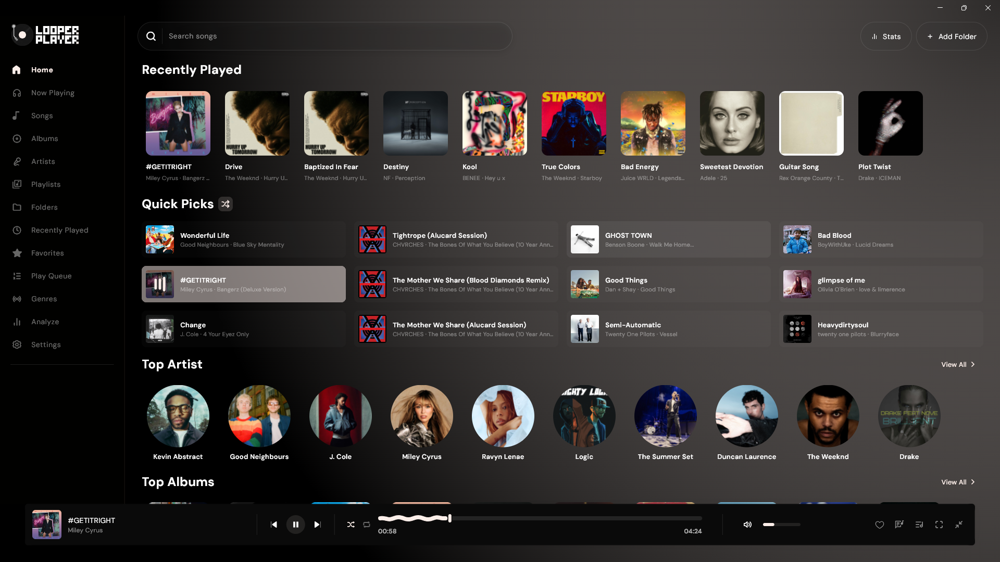
</p>

<p align="center">
  <b>Synchronized Karaoke-Glow Lyrics Engine</b><br/>
  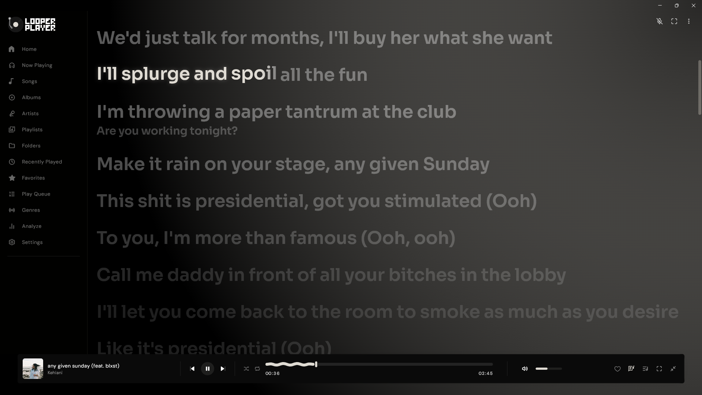
  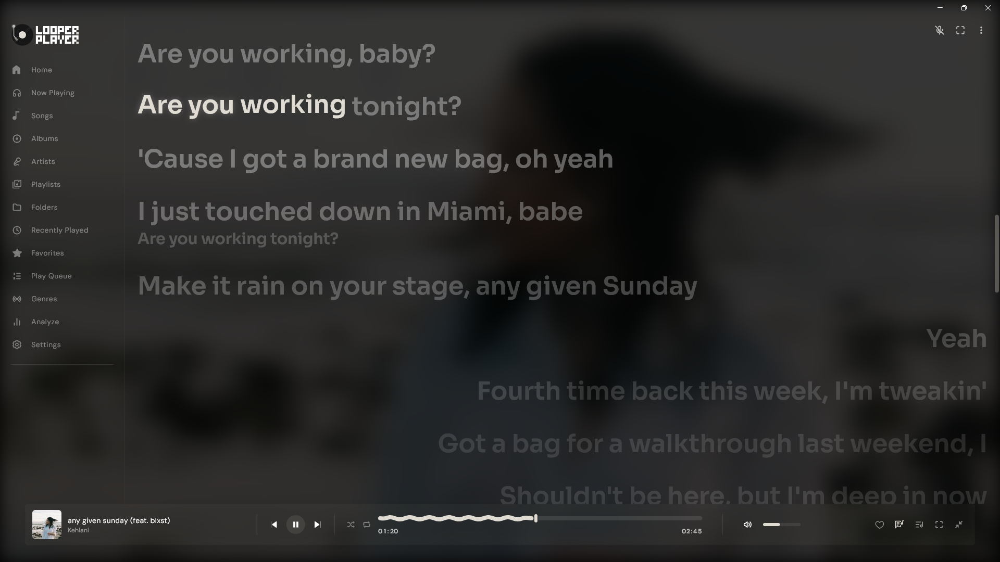
</p>

<p align="center">
  <b>Desktop Expanded Player with Real-Time Spectrum Visualizer</b><br/>
  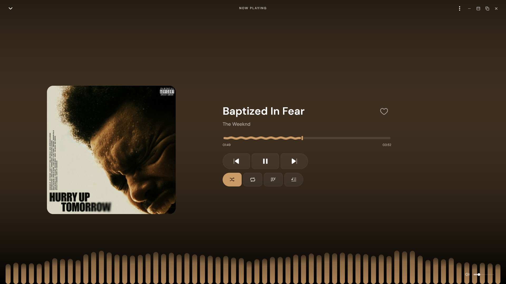
</p>

<p align="center">
  <b>Dual Floating Mini-Players (Standard & Corner Modes)</b><br/>
  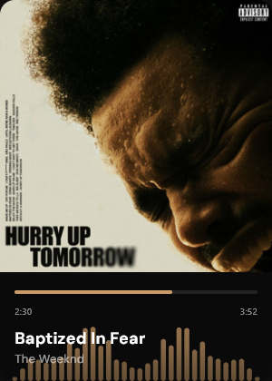
  &nbsp;&nbsp;&nbsp;&nbsp;
  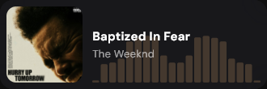
</p>

<p align="center">
  <b>Looper Analyze (Listening Trends & Stats)</b><br/>
  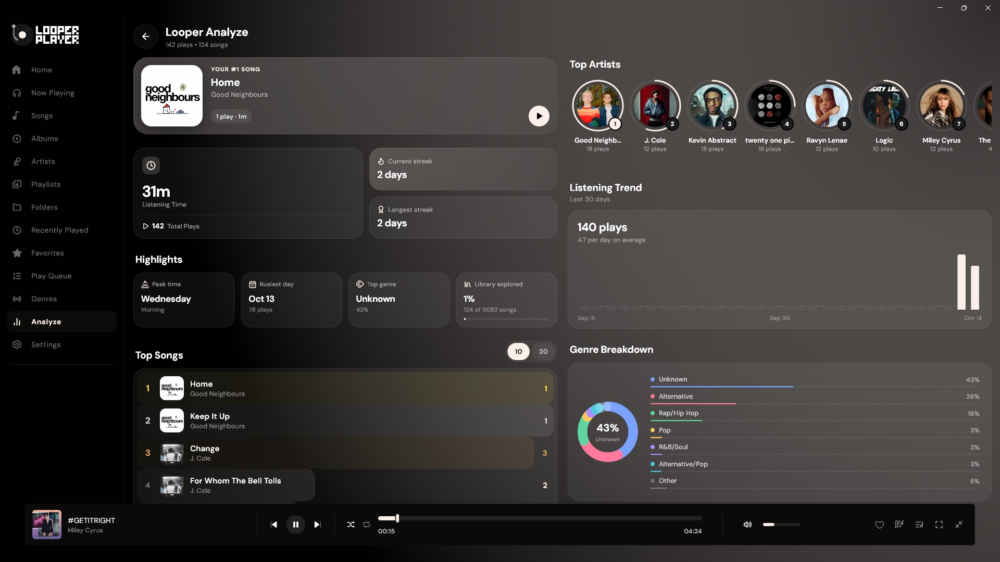
</p>

<p align="center">
  <b>Global Instant Search with In-Song Lyrics Matching</b><br/>
  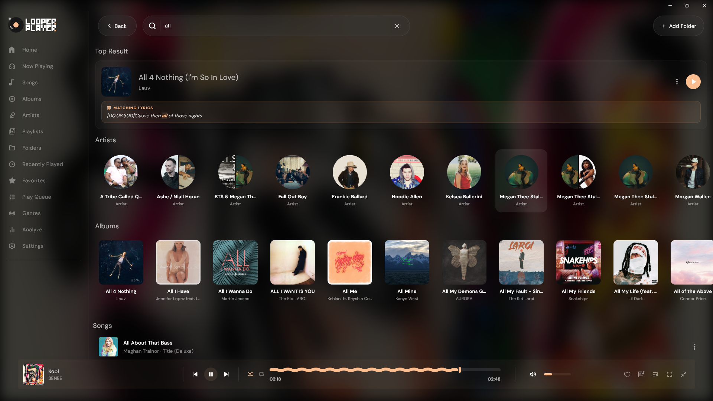
</p>

<p align="center">
  <b>Library Albums & Artists Views (Adaptive Theming)</b><br/>
  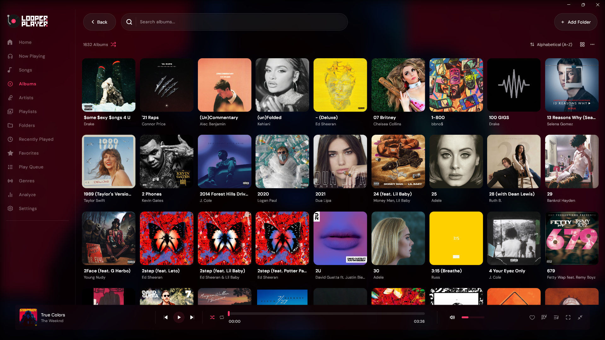
  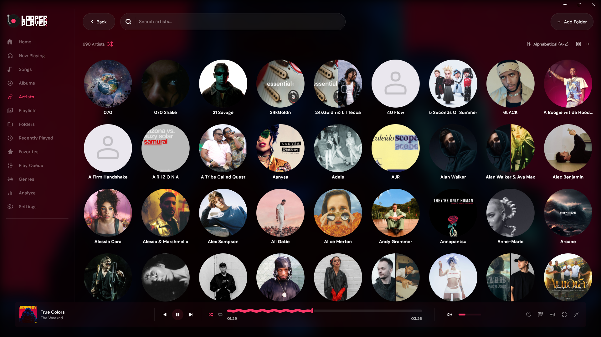
</p>

<p align="center">
  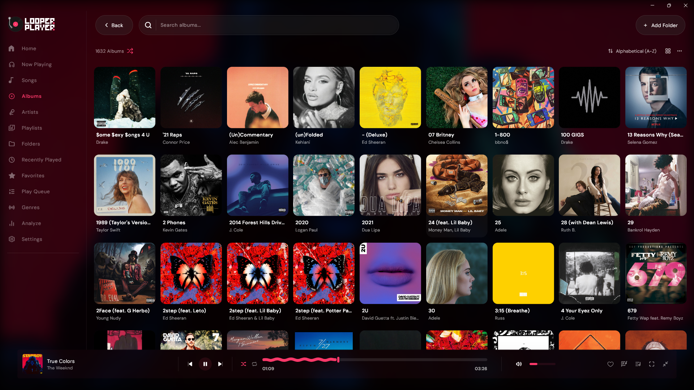
  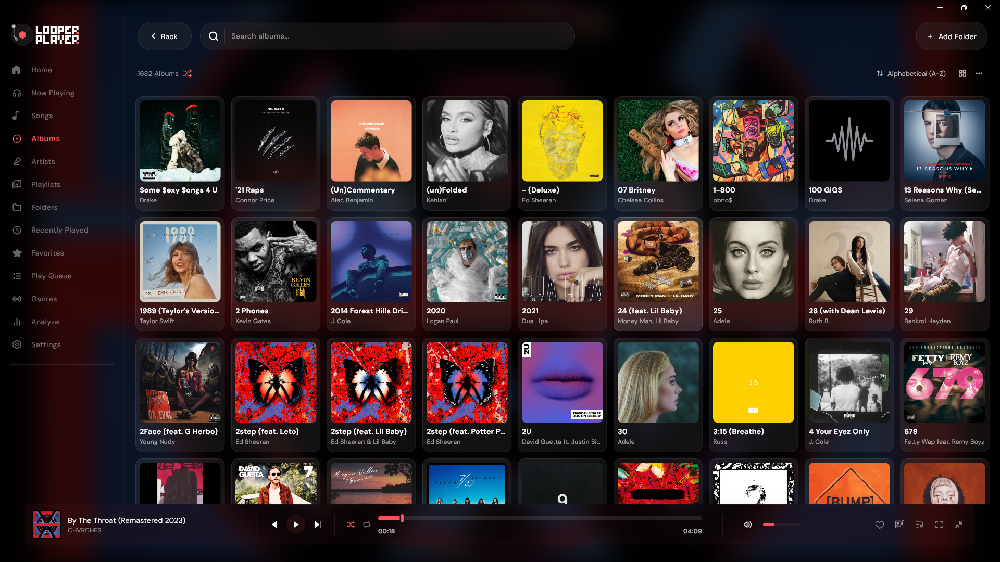
</p>

<p align="center">
  <b>OLED Pure Black Mode & Flat Progress Bar</b><br/>
  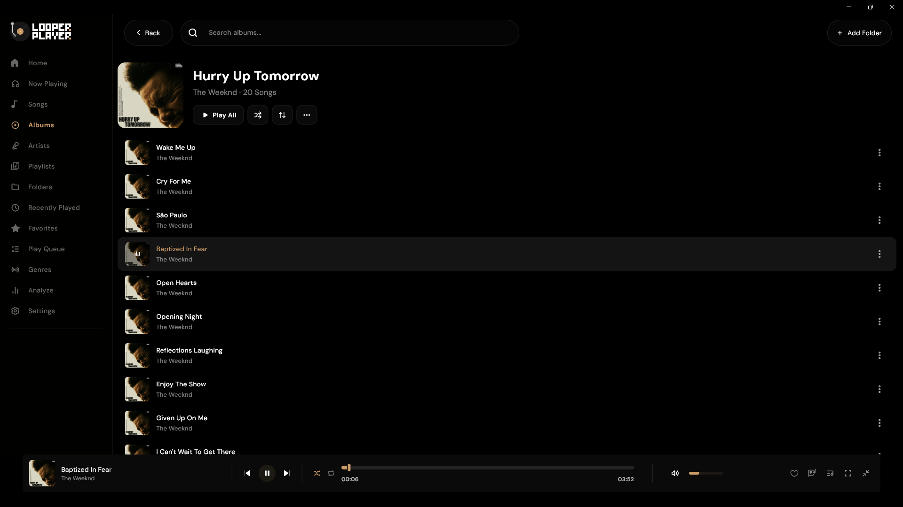
  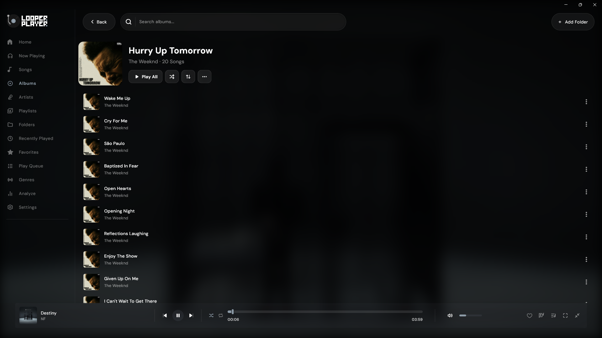
</p>

<p align="center">
  <b>Settings & Customization Suite</b><br/>
  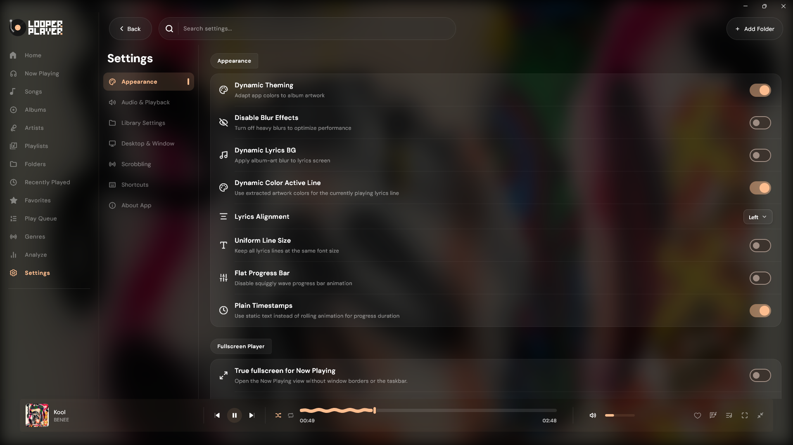
</p>

---

## 🛠️ The Tech Stack

```
        ┌────────────────────────────────────────────────────────┐
        │                  LOOPER ARCHITECTURE                   │
        ├────────────────────────────────────────────────────────┤
        │  UI Framework      │  Flutter & Dart (Desktop Native)  │
        ├────────────────────┼───────────────────────────────────┤
        │  Database Engine   │  Isar DB (Zero-Allocation Local)  │
        ├────────────────────┼───────────────────────────────────┤
        │  Audio Backend     │  libmpv C-bindings (mpv_audio_kit)│
        ├────────────────────┼───────────────────────────────────┤
        │  State Management  │  Riverpod (Scoped Observables)    │
        └────────────────────┴───────────────────────────────────┘
```

---

## 📦 Installation & Setup

Download the production build for your platform from the [GitHub Releases](https://github.com/mikiyasmechalo/looper/releases) page.

### 🪟 Windows (x64)

We offer two formats for Windows:

1. **Setup Wizard (`Looper-Setup-x64.exe`)** *(Recommended)*:
   - Double-click to run the setup wizard.
   - Installs directly to user programs (`%LOCALAPPDATA%\Programs\Looper`) without requiring Administrator privileges.
   - Automatically adds Desktop & Start Menu shortcuts.
   - Registers audio file associations (`.mp3`, `.flac`, `.wav`, `.m4a`, `.ogg`, `.opus`, `.aac`).
   - Clean, standard uninstaller in Windows Settings / Installed Apps.

2. **Portable Archive (`looper-windows-x64-portable.zip`)**:
   - Extract anywhere (USB drive, Desktop, Program folder).
   - Double-click `looper_player.exe` to run immediately with zero installation.

---

### 🐧 Linux Packages (x86_64)

We provide native packages across all major Linux distributions:

#### 🚀 AppImage (Universal Standalone)
Works across modern Linux distributions out of the box with zero installation:
```bash
chmod +x looper-player.AppImage
./looper-player.AppImage
```

#### 📂 Debian / Ubuntu / Mint (`.deb`)
```bash
sudo apt install ./looper-player.deb
```

#### 📂 Fedora / RHEL / openSUSE (`.rpm`)
```bash
# Fedora / RHEL
sudo dnf install ./looper-player.rpm

# openSUSE
sudo zypper install ./looper-player.rpm
```

#### 📦 Portable Archive (`.tar.gz`)
Extract and run in your user environment:
```bash
tar -xzvf looper-player-linux.tar.gz
cd universal
./run.sh
```

> [!TIP]
> **Linux Prerequisites**: Looper Player relies on `libmpv` for high-fidelity playback. If not already installed on your system:
> - **Ubuntu / Debian / Mint**: `sudo apt install libmpv2` (or `libmpv1`)
> - **Fedora**: `sudo dnf install mpv-libs`
> - **Arch Linux**: `sudo pacman -S mpv`

---

## 🏗️ Building From Source

1. **Prerequisites**:
   - [Flutter SDK](https://flutter.dev/docs/get-started/install) (3.24+ recommended)
   - C++ Build Tools:
     - **Windows**: Visual Studio Build Tools (C++ Desktop Development)
     - **Linux**: `clang`, `cmake`, `ninja-build`, `pkg-config`, `libgtk-3-dev`, `libmpv-dev`, `libnotify-dev`

2. **Clone and run**:
   ```bash
   git clone https://github.com/mikiyasmechalo/looper.git
   cd looper
   flutter pub get
   ```

3. **Run in development**:
   ```bash
   # Windows
   flutter run -d windows

   # Linux
   flutter run -d linux
   ```

4. **Build release binaries**:
   ```bash
   # Windows
   flutter build windows --release

   # Linux
   flutter build linux --release
   ```

---

## 👥 Contributors & Open Source

A massive thank you to the creators and open-source communities that make Looper Player possible:

### Project Maintainers
* **Mikiyas Mechalo** — *Lead Maintainer & Desktop Architecture* ([GitHub](https://github.com/mikiyasmechalo) • [Telegram](https://t.me/mikeme2))
* **Nilesh Suthar** — *Original Creator & Architect* ([GitHub](https://github.com/SthrNilshaaa) • [Telegram](https://t.me/neelshy))
* **Karan Suthar** — *Original UI/UX & Interaction Design* ([GitHub](https://github.com/sthrkaran) • [Telegram](https://t.me/karanwhy))

---

## 📄 License

This project is open source and licensed under the [GPL-3.0 License](LICENSE).
